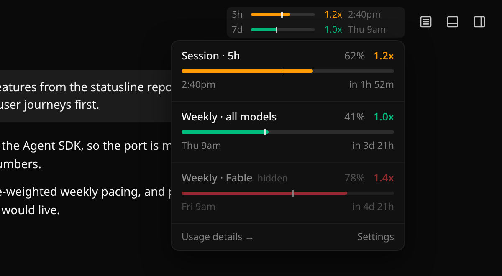
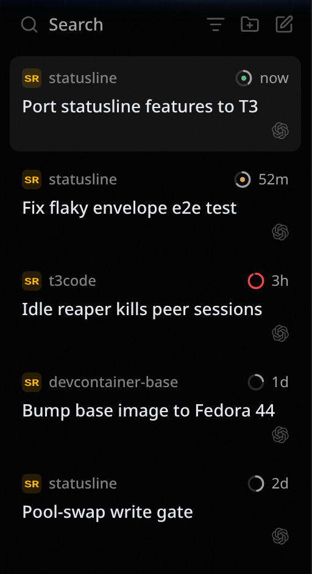

# Usage pacing and thread context glyph: design

Date: 2026-10-11 · Branch: `feat/usage-pacing` · Base: `v0.0.46-nightly.20261011.2980`

## 1. Purpose

Port the useful parts of the Claude Code terminal statusline (`~/Code/statusline`) into
this fork of T3 Code. The aim is not to reproduce the bar: each piece of information goes
where the user looks for it at the moment they need it.

T3 already receives rate-limit windows, per-turn token usage and the prompt-cache TTL.
What this adds is **projection** (is my usage pace sustainable?), **schedule awareness**
(judged against when I actually work), and **per-thread cache and context state** shown
where threads are chosen.

Only Claude needs to work now. The shapes stay provider-agnostic where that costs
nothing; anything beyond that is out of scope until needed.

## 2. User journeys

| #   | Journey                                                   | Moment                                                 | Surface                                            |
| --- | --------------------------------------------------------- | ------------------------------------------------------ | -------------------------------------------------- |
| J1  | Pacing the 5h session: "can I start this big task now?"   | Before sending or dispatching agents, many times a day | Header pacing widget, always visible               |
| J2  | Pacing the week: "am I on track given my hours?"          | Several times a day, less often than J1                | Same widget, weekly row(s)                         |
| J3  | Coming back to a thread: "is it still cheap to continue?" | Picking a thread from the sidebar, or before sending   | Cache dot on every sidebar row and in the composer |
| J4  | Context getting full: "compact or start fresh?"           | Before sending, or when choosing a thread              | Context ring (same glyph as J3)                    |

Out of scope: overage and extra-cost tracking, warnings in the model picker, the mobile
app.

## 3. UI

The mockups in `assets/usage-pacing/` were captured from this fork's real web UI with
the elements injected into the DOM. Two details changed after they were captured: the
warm cache dot is now **grey** (it shows green in the images), and the ring's colour
tiers follow §4.4.

### 3.1 Header pacing widget

- **Placement:** the chat header's right side, immediately left of the panel-layout
  controls. The header's reserved right padding grows so the breadcrumb truncates
  rather than overlapping the widget.
- **Layout:** one row per enabled window, stacked vertically, in this order: session
  (5h), weekly (all models), model-scoped weekly (Fable today).
- **Row contents, left to right:**
  - Label in muted text: `5h`, `7d`, `Fable` (from the scoped window's display name).
  - Bar: 76 px wide, 3 px tall. The fill is `usedPercent` in the burn colour. A 1.5 px
    tick in the foreground colour marks the pace position (§4.3).
  - Burn: `1.2x` in the burn colour, right-aligned in a fixed-width column.
  - Reset time in muted grey: a clock time for windows of a day or less (`2:40pm`),
    weekday plus hour otherwise (`Thu 9am`). Always the reset time, never a run-out time.
- **Spacing:** 11 px text. The row gap is 5 px with one or two rows and 1 px with three.
- **Visibility:**
  - A row appears only if its window exists in the active thread's provider
    `usageLimits` _and_ its toggle is on (§3.4).
  - The widget renders nothing when no rows qualify, for example when the provider
    reports no windows or `unavailable`.
  - When the burn can't be computed yet (§4), the row keeps its bar and reset time and
    leaves the burn column blank.
- **Narrow headers:** below 560 px of header width, the reset column is dropped. Below
  420 px, the widget is hidden. This is a container query on the header, not on the
  viewport.
- **Interaction:** hovering opens the popover (§3.2) and clicking pins it open. A
  pinned popover closes on outside click or Escape.

### 3.2 Pacing popover

- **Size:** 280 px wide.
- **Sections:** one per window the provider reports, _including windows toggled off in
  the header_. Those are drawn at 55% opacity with a muted `hidden` tag after the title.
- **Section layout, each line using both edges:**
  1. Title (`Session · 5h`, `Weekly · all models`, `Weekly · Fable`) on the left;
     `62%` (muted) and `1.2x` (burn colour, semibold) on the right.
  2. A full-width bar, 4 px tall, with the pace tick.
  3. Reset clock time on the left (`2:40pm`); countdown on the right (`in 1h 52m`).
- **Footer:**
  - `Usage details →` navigates to `/usage`.
  - `Settings` opens the Usage pacing settings section.
- **No explanatory prose.** Data only.

### 3.3 Thread context glyph (ring + cache dot)

 

A single SVG glyph, used in two places:

- **Sidebar:** 14 px, on every thread row, immediately before the relative timestamp in
  the row's top status slot.
- **Composer:** 18 px, replacing the current `ContextWindowMeter` ring in the same slot.
  The meter's existing popover stays (tokens, cost, Compact action, resume-compaction
  offer); the meter's toggle is covered in §3.4.

Geometry and colour:

- **Ring:**
  - Stroke 1.6 px at 14 px, 2 px at 18 px, round caps.
  - Track: muted foreground at 25% opacity. Arc starts at 12 o'clock and runs clockwise
    for the context fraction.
  - Colour comes from the context tier (§4.4), using the shared tier palette below.
- **Dot:** radius 15% of the glyph size, filled with
  `color-mix(in oklab, <state colour> 45%, var(--muted-foreground))`.
  - Warm: state colour is `--muted-foreground`, so the dot is plain grey.
  - Expiring: state colour is `--warning`.
  - Cold or unknown: no dot.

Data and states:

- **No data:** a thread with no token usage at all (never ran a turn, or a provider
  that doesn't report usage) shows no glyph.
- **Unknown cache state:** a thread with token usage shows the ring even when cache
  state is unknown. The dot is then simply absent.
- **Tooltip** (sidebar and composer):
  `Context 380k / 1M (38%) · Cache warm, expires 3:12pm`. The cache clause becomes
  `Cache expiring 3:12pm`, `Cache cold`, or is omitted when unknown.
- **The composer reads the active thread's live usage**, as today. The sidebar reads
  the shell summary (§5.3).

### 3.4 Settings

A new **Usage pacing** section in the settings sidebar holds per-device client settings
(`ClientSettingsSchema`), each registered in `settingsSearch.ts`:

| Setting                          | Control                                                                         | Default     |
| -------------------------------- | ------------------------------------------------------------------------------- | ----------- |
| Show session (5h) window         | switch                                                                          | on          |
| Show weekly window               | switch                                                                          | on          |
| Show model-scoped weekly windows | switch                                                                          | on          |
| Work hours                       | time range (`HH:MM`–`HH:MM`; an end at or before the start wraps past midnight) | 09:00–17:00 |
| Work days                        | weekday multi-select, reusing the scheduled-tasks weekday picker                | Mon–Fri     |
| Off-hours weight                 | number 0–1, step 0.05                                                           | 0.2         |

`contextWindowMeterEnabled` moves out of the "legacy" group, is relabelled **Show
context ring in composer**, and its default changes to **on**. The sidebar glyph has no
toggle.

Every other statusline knob becomes a fixed constant (§4).

## 4. Computation

These are pure functions in `packages/shared/src/usagePacing.ts`, ported from the
statusline with its tests (`burn-tier`, `burn-rate`, `weekly-burn`, `cache-warmth`). All
time-dependent values recompute on a shared 30 s client tick, as well as on data change.

### 4.1 Burn colour ladder (from `burn-tier.ts`)

- `roundBurn(x) = round(x * 10 + 1e-9) / 10`. Colour tiers come from the **rounded**
  value.
- `burnTier(b, greenCut = 1.0, exponent = 1)`:
  - green when `b <= greenCut`
  - yellow when `b <= 1.15^exponent`
  - orange when `b <= 1.3^exponent`
  - red otherwise
- Colours (the **tier palette**, shared with the context ring in §3.3):
  green `--success`, yellow Tailwind `yellow-400`, orange Tailwind `orange-500`, red
  `--destructive`. The ring's lowest tier uses `--muted-foreground` instead of green.

### 4.2 Burn per window

**Session windows** (`kind: "session"`) use an EWMA of the observed rate, ported
verbatim from `computeBurn` in `burn-rate.ts`:

- Constants: window 18000 s, half-life 1800 s, idle cap 3600 s, minimum observation
  90 s, fallback minimum elapsed 1800 s.
- Input: the window's `history` (§5.2), filtered to the current `resetsAt` and the last
  `windowSec`.
- Rate: walk intervals newest to oldest, weighting each by `exp(-ln2 * age / HL)`. Stop
  at a drop greater than 0.1 points or a gap longer than the idle cap.
  - With at least 2 intervals and at least 90 s observed: `rate = Σw·du / Σw·dt`.
  - Otherwise, with at least 1800 s of the window elapsed: `rate = used / elapsed`.
  - Otherwise there is no burn.
- `burn = (used + rate * remaining) / 100`.
- Dynamic cutoffs: `greenCut = 1 + 0.1 * remaining/window`, and
  `exponent = 1 + 2 * (1 - 10 / (remaining/elapsed + 10))`.

**Weekly windows** (`kind: "weekly"`, model-scoped ones included) use
`computeWeeklyBurn` from `weekly-burn.ts`:

- `burn = roundBurn((used / 100) / frac)`, where `frac` is the schedule-weighted
  elapsed fraction of the window.
- No burn while `frac < 0.02`.
- `windowDurationMins` comes from the window, falling back to 10080.
- `scheduleWeight` integrates a weight per local second, walking local calendar days so
  DST stays correct:
  - work-hours seconds on a work day weigh 1
  - other seconds on a work day weigh the off-hours weight
  - seconds on non-work days weigh 0
  - The statusline hardcoded Sat/Sun as non-work days; here that becomes the "work
    days" setting.

Other window kinds (`monthly`, `other`) use the weekly formula with a wall-clock
fraction, i.e. no schedule. That makes other providers work without special cases.

### 4.3 Pace tick position

The tick marks the elapsed fraction the burn uses, so the fill-versus-tick picture and
the burn number always agree:

- session windows: wall-clock elapsed fraction
- weekly windows: schedule-weighted `frac`

### 4.4 Context ring tier

The ring takes the more severe of two tiers. `pct = usedTokens / maxTokens`;
`tokens = usedTokens`.

| Tier   | By % of window | By absolute tokens |
| ------ | -------------- | ------------------ |
| grey   | < 50%          | < 200k             |
| yellow | ≥ 50%          | ≥ 200k             |
| orange | ≥ 65%          | ≥ 300k             |
| red    | ≥ 80%          | ≥ 400k             |

The % tiers are lower than the statusline's (50/75/90) because auto-compact fires before
the window fills. Without `maxTokens`, only the token tier applies.

### 4.5 Cache warmth (from `cache-warmth.ts`)

Inputs: the latest top-level token usage report's `updatedAt`, `promptCacheTtlMs`, and
request identity (§5.3).

- **unknown** when there's no report, or no TTL has ever been observed for the thread.
- **cold** when either:
  - `now >= updatedAt + ttl`, or
  - the identity mismatches. Compare model, effort and fast mode between the last
    request and the next one; a field absent on either side is skipped.
- **expiring** when the time remaining is less than `min(600 s, ttl / 4)`.
- **warm** otherwise.

"The next one" means:

- for the active thread in the composer, the composer's currently selected model
  selection, so changing the picker updates the dot immediately;
- in the sidebar, the thread's `modelSelection`.

## 5. Data and architecture

### 5.1 Rate-limit freshness fix (server)

**The bug:** today `claudeRateLimitEventToUpdate` updates only the window named by
`rateLimitType`. In production logs, once the weekly window reached `allowed_warning`,
every event named `seven_day`, so five-hour updates were dropped until the next 5-minute
probe.

**The fix:** every `rate_limit_info` also carries an untyped
`unifiedWindows: {five_hour: {utilization, resetsAt}, seven_day: {…}}`. Read it
structurally, and update every window it lists on every event, keeping the current
single-window path as the fallback when it's absent.

Test: an event with `rateLimitType: "seven_day"` and `unifiedWindows` updates both
windows.

### 5.2 Usage history for session burn (server)

- **Recording:** `ManagedServerProvider` keeps an in-memory sample list per provider
  instance for windows of `kind: "session"`. Each entry is `{ at, usedPercent }`,
  appended on every usage update (event or probe), even if the value didn't change.
  Probes therefore act as idle heartbeats.
- **Pruning:** samples are discarded when `resetsAt` moves to a new window, when
  `credentialFingerprint` or `workspaceId` changes (an account swap), and beyond 400
  entries.
- **Transport:** exposed as an optional `history: Array<{at: IsoDateTime, usedPercent}>`
  on `ServerProviderUsageWindow`, sent only for session windows.
- **No persistence:** after a server restart, the burn uses the linear fallback until
  enough samples exist. This is the accepted trade.
- Nothing from the statusline's envelope or pool-swap machinery is ported. It existed
  because every Claude Code session re-emitted its own stale payload; T3 has a single
  authoritative snapshot per provider instance.

### 5.3 Per-thread token usage in the shell (server + contracts)

- **New identity field:** `OrchestrationV2ProviderTurnTokenUsage` gains an optional
  `requestIdentity: { model?: string, effort?: string, fastMode?: boolean }`.
  `ClaudeAdapterV2` fills it on the top-level assistant usage path: `message.model`, plus
  effort and fast mode from the turn's `modelSelection`.
- **Carried-forward TTL:** when a report has no `promptCacheTtlMs` (a turn that only
  read cache), the adapter carries forward the thread's last known TTL. The TTL scan
  continues past the newest entry for the same reason as in the statusline.
- **On the shell:** `OrchestrationV2ThreadShell` gains an optional `latestTokenUsage`,
  the newest top-level token usage of the thread's active provider thread.
  - Sourced from the persisted provider-turn rows, so historical threads get a ring with
    no backfill.
  - Updated live whenever a provider turn's `tokenUsage` changes.
  - It follows the existing `goal` pattern (`activeProviderGoalForShell`) for reaching
    the shell. The plan picks the exact projection mechanics.
- **Regression test** pinning the 0.0.45 bug's cause: a `task_progress` or
  `task_notification` frame with a large `usage.total_tokens` must not change any
  `tokenUsage`.

### 5.4 Web

- **`PacingWidget` and `PacingPopover`:** new, mounted from `ChatView` into the header's
  top-right controls area. They read `ServerProvider.usageLimits` for the active
  thread's provider instance, plus client settings.
- **`ThreadContextGlyph`:** new and shared. Used in `SidebarThreadRow` (from
  `latestTokenUsage`) and inside `ContextWindowMeter` (from the live snapshot), where it
  replaces the ring drawing.
- **The Usage pacing settings section:** new.
- **Clock:** a `useNowTick(30_000)` hook drives time-dependent re-renders, one interval
  shared across all consumers.

## 6. Degraded states

| Condition                                      | Behaviour                                      |
| ---------------------------------------------- | ---------------------------------------------- |
| Provider has no `usageLimits` or `unavailable` | Widget hidden                                  |
| Window lacks `resetsAt`                        | Row shows bar only; no burn, no tick, no reset |
| Session burn not computable yet                | Burn column blank                              |
| Weekly `frac < 0.02` (window just started)     | Burn column blank                              |
| Thread has no token usage                      | No glyph                                       |
| No TTL ever observed                           | Ring only, no dot                              |
| `maxTokens` missing                            | Track only, no arc; colour by the token tier   |

## 7. Testing strategy

**Hermetic** (`vp test run` on touched files only, per `AGENTS.md`):

- Port the statusline's burn-tier, burn-rate, weekly-burn (including DST and the
  wrap-past-midnight schedule) and cache-warmth tests to `usagePacing.test.ts`. Add
  coverage for configurable work days and the 50/65/80 context tiers.
- Server:
  - the `unifiedWindows` mapping
  - history recording, pruning and reset on window or account change
  - `requestIdentity` and TTL carry-forward in `ClaudeAdapterV2.test.ts`
  - the task-progress regression test
  - `latestTokenUsage` reaching the shell, live and for historical threads
- Web logic: row visibility from toggles, the narrow-header breakpoints, and the
  tooltip text.

**End-to-end**, against this worktree's dev server (`vp run dev`, isolated `.t3`
state), driven by Playwright in headless Chrome as approved, with screenshots saved for
the handoff:

1. Run real Claude turns in a dev project. The header shows 5h/7d rows whose percentages
   match `/usage` and the provider snapshot.
2. After enough samples, the session burn appears; the weekly burn appears immediately.
   Toggling a window off hides its row and leaves it in the popover as `hidden`.
3. The sidebar and composer glyphs appear after a turn, and the dot is present while
   warm. Switching the composer's model or effort removes the dot immediately (an
   identity mismatch); switching back restores it.
4. Run a turn that uses subagents or a workflow. The ring stays at the real context size
   (no 1m/1m).
5. Restart the server. The widget recovers and the burn returns to the linear fallback.
6. Change work hours and days, and the weekly burn and tick move accordingly.

Time-based expiry (5 min / 1 h) is covered hermetically, not by waiting it out in the
end-to-end run.

## 8. Implementation location

- **Branch:** `feat/usage-pacing` (local; no upstream)
- **Worktree:** `/home/jorgen/Code/t3code/.claude/worktrees/usage-pacing`
- **Base branch:** `v0.0.46-nightly.20261011.2980` (upstream `main` as of 2026-10-11).
  The user will move their daily T3 to the nightly channel and later to a build of this
  branch. Building and installing that fork build is a plan item.

## 9. Decisions made on the user's behalf (override if wrong)

1. **Narrow headers** degrade by dropping the reset column below 560 px and hiding the
   widget below 420 px, rather than wrapping or moving it elsewhere.
2. **Usage history is in memory only.** After a T3 restart, the 5h burn takes up to
   about 30 minutes of activity to regain its recency weighting; until then it uses
   the simpler linear projection.
3. **The context ring is on by default in the composer** (T3's meter was off by
   default), and the sidebar glyph is always on.
4. **Non-Claude threads** show whatever windows their provider reports, with the same
   burn logic, untested beyond Claude.
